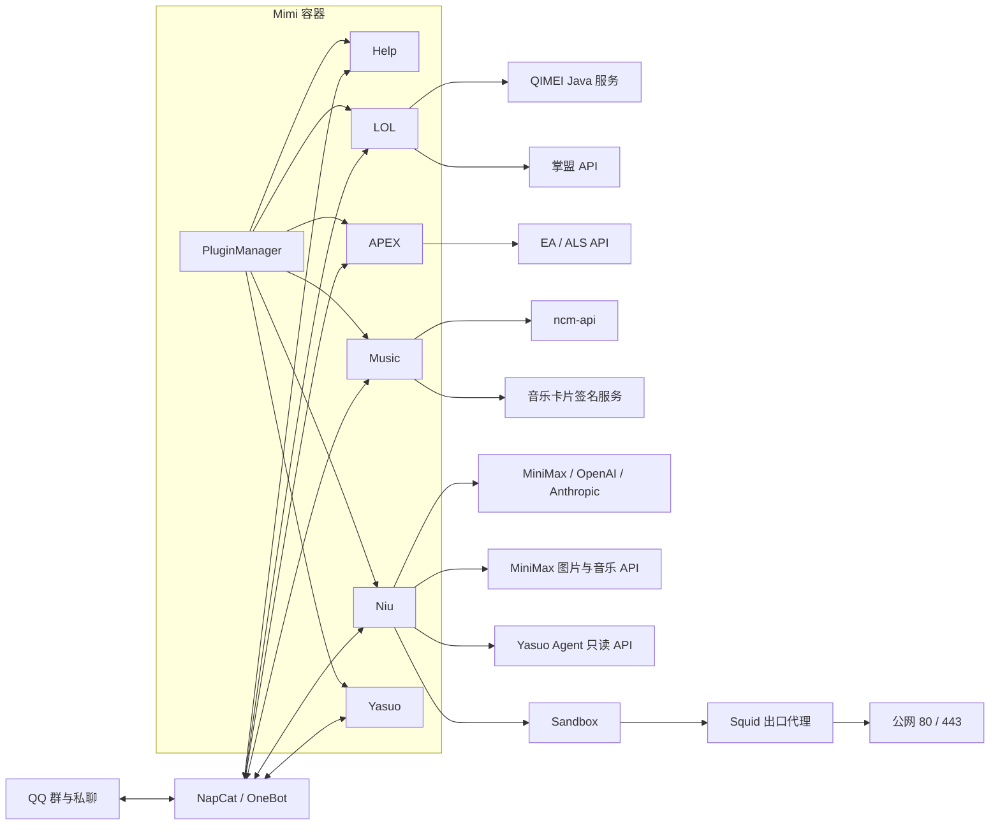

# Mimi Architecture

本文件是 Mimi 架构现状的唯一描述来源，回答“系统长什么样、组件如何交互、状态归谁”。
实现约束和验证门槛见 [`AGENTS.md`](AGENTS.md)，特性形成过程见
[`docs/feature/`](docs/feature/README.md)。本文只描述当前分支，不记录临时方案。

## 鸟瞰

Mimi 是基于 NapCat/OneBot 的插件化 QQ 机器人。仓库采用单仓库、多进程结构：

- Docker Compose 提供 NapCat、网易云 API、QIMEI、Mimi、Sandbox 和受控出口代理。
- Mimi 根进程扫描 `plugins/*`，校验命令清单并启动插件子进程。
- 每个插件拥有独立 Python 环境、NapCat WebSocket、业务代码和运行数据。
- 插件之间不直接导入；共享的是环境变量、NapCat 服务和明确的 HTTP 服务。



## 运行视图

| 运行单元 | 职责 | 状态 |
| --- | --- | --- |
| `napcat` | QQ 登录、OneBot 事件与消息发送 | `data/napcat/` |
| `ncm-api` | 网易云搜索、登录和账户接口 | 外部服务状态 |
| `qimei` | 通过 Unidbg 与原生库注册 QIMEI36 | `data/qimei/` 仅缓存 APK |
| `mimi` | 根进程与全部插件子进程 | 插件数据卷 |
| `sandbox` | 降权执行 Niu 的一次性 Code Tool 与 Run 级 Workspace Tool | `/workspaces` tmpfs |
| `sandbox-egress-proxy` | 代理 Sandbox 公网流量并拒绝私网目标 | 无持久状态 |

`mimi/main.py` 创建 `PluginManager`。管理器扫描 `plugins/` 的直接子目录，读取
`commands.toml` 并做全局、大小写不敏感的命令去重，然后在每个插件目录执行
`uv run main.py`。插件 stdout/stderr 由独立线程转发到根日志。

插件自行建立 NapCat WebSocket 并处理断线重连。这个设计用额外连接换取依赖与故障隔离；
当前管理器不会主动拉起已经退出的插件子进程，容器级异常由 Compose 重启策略处理。

## 源码视图

```text
mimi/
  main.py                 # composition root
  plugin.py               # 插件发现、命令校验、子进程管理
  client.py               # 根 NapCat 客户端
plugins/
  help/                   # 命令清单聚合与帮助海报
  lol/                    # 掌盟登录、战绩、详情与海报
  apex/                   # EA 战绩、绑定与地图轮换
  music/                  # 网易云搜索、登录与音乐卡片
  niu/                    # 群聊 AI
  yasuo/                  # 群消息归档、撤回海报与查询 API
qimei/
  src/main/java/qimei/    # QIMEI HTTP、APK 校验、Unidbg 调用
sandbox/
  app.py                  # 执行 API、限额、降权与产物收集
  entrypoint.sh           # 任务 UID 出口防火墙
  squid.conf              # 公网代理目标与端口策略
```

复杂插件采用以下依赖方向：

```text
main / config
    -> dispatcher
        -> feature handlers
            -> HTTP services / auth
            -> dataclass domain models
            -> Tortoise persistence models
            -> poster context
                -> Jinja2 template
                -> asset cache
                -> pytakumi PNG
```

入口负责装配与生命周期，dispatcher 只匹配命令，feature 编排用例，服务层隔离外部协议，
模型层表达数据，渲染层只消费稳定上下文。早期插件尚未完全统一，但新增代码遵循该方向。

## 状态所有权

| 状态 | 所有者 | 存储 |
| --- | --- | --- |
| QQ 登录与 NapCat 配置 | NapCat | `data/napcat/` |
| APEX 用户绑定与资产 | APEX 插件 | `data/mini/plugins/apex/data/` |
| LOL 端游/手游独立用户绑定、唯一共享会话、设备 profile、QIMEI36 | LOL 插件 | `data/mini/plugins/lol/data/` |
| Niu 群级性格、长期记忆、群表情库与 Agent 审计 | Niu 插件 | `data/mini/plugins/niu/data/` |
| 群消息、撤回事件与下载图片 | Yasuo 插件 | `data/mini/plugins/yasuo/data/` |
| QIMEI 所需固定 APK | QIMEI 服务 | `data/qimei/` |
| 网易云 Cookie | Music 插件 | 配置的数据文件 |

运行数据不属于源码，不进入 Git 或 Docker 构建上下文。QIMEI 服务不拥有设备身份；
LOL 插件以 profile digest 校验 QIMEI36 缓存，缓存未命中时才调用服务。

## LOL 核心链路

管理员通过 QQ OAuth 建立唯一共享掌盟会话。普通用户绑定 Riot ID、手游角色名或直接
输入昵称，插件先按游戏类型搜索玩家，再查询战绩：

```text
昵称
  -> /go/customize_search/search_type_keyword
  -> scene + uuid + area_id
  -> /go/battle_info/get_battle_list
  -> 能力信息 + 各局详情
  -> 中文战绩海报
```

手游链路使用 `gameId=lgame` 和搜索结果的 `lgameIntent`，再调用
`/go/lgame_battle_info/battle_list`、`overview` 和 `detail_v2`。端游与手游共享登录态，
但绑定表和进程内最近查询状态彼此独立。

掌盟请求固定使用 `lolapp/12.8.1 (Android)` User-Agent。模式以 `game_queue_id`
判断：`450` 为极地大乱斗，`3270` 为海克斯大乱斗。掌盟未提供的隐藏分/MMR 不估算。

登录时，LOL 插件把设备原生配置发送给 QIMEI 服务。QIMEI 服务串行运行 ARM64
`libqimei.so`，返回 QIMEI36；插件将其作为 `mcode` 完成掌盟登录并持久化票据。

## Niu Agent 链路

Niu 使用文本前缀或直接 @ 开启群级连续话题。话题按群保存在进程内，具有独立
`topic_id`、120 秒默认空闲超时和 900 秒默认最长存活时间；相关群友消息可在窗口内直接
追问或补充。普通消息先经过 `ModelTopicGate` 的受限分类，分为忽略、静默吸收和立即回复；
只 @ 其他成员、其他插件命令、低置信消息及无关聊天不进入 Agent 历史，也不刷新超时。
`ConversationStore` 为每个群维护有界 FIFO 队列和按 `topic_id` 隔离的短期完整轮次，
`AgentLoop` 只依赖 `ModelProvider`，通过内部统一的请求、内容块、工具
调用、停止原因、用量和错误模型调用 MiniMax、OpenAI 或 Anthropic。厂商协议转换留在
`providers/model.py`；MiniMax 和 Claude 使用 Anthropic 消息协议，GPT 使用 OpenAI Chat
Completions 协议。模型请求只在调用期间占用全局并发槽位，工具执行和媒体发送不占用模型
槽位；单条业务失败不会重建 NapCat 连接。入口在任何解析前丢弃
`user_id == self_id` 的事件，防止机器人回复或代发指令再次触发 Niu；其他群消息即使未
触发对话，也会旁路收集 `MFace` 和 NapCat 明确标记为 `Image(sub_type=1)` 或
`Image(file=marketface)` 的自定义表情。

插件内部按职责分为 `adapters/` QQ 协议适配、`core/` Agent 编排与工具协议、
`domain/` 领域模型和持久化，以及 `providers/` 外部服务适配；入口只负责装配这些边界。
`core/skills.py` 只负责 Skill 元数据、加载、路由和 Tool 绑定校验；缺失 Skill、未知或
非法 frontmatter、空正文及 Tool 声明不一致都会使启动失败。能力目录仅暴露经过 XML
转义的适用场景、显式触发词、示例、排除项和 Tool 名称。`core/tools.py` 只定义 Tool
协议、注册表和执行边界。Agent 控制 Tool 与回复 Tool 分别和对应的
`core/runtime.py`、`core/reply.py` 放在一起；图片和音乐 Tool 跟随外部媒体 Provider
放在 `providers/media_tools.py`，因此 core 不反向导入 providers。
`PromptCatalog` 严格加载安全、任务执行、群聊表达和 NapCat 协议四层固定提示词，并以
独立 XML section 组装能力目录、低优先级记忆、上一话题检查点、激活 Skill、任务状态和
当前运行指令；每轮只注入最新状态，记忆与话题检查点在进入 section 前转义。显式唤醒先由
受限模型判断 `TaskRelation`：继续、纠正和补充复用当前 Task，独立或无关请求创建新
`topic_id`，低置信关系进入最小澄清路径。紧邻的上一话题由 TaskState 的目标、Evidence、
最新结果、未完成项和状态组成有界检查点；不直接读取旧话题原文或继承上一成员权限。QQ 适配层通过
当前 NapCat 连接解析成员 At
和引用消息，向领域层提供带成员 ID、昵称快照、来源标记的文本与图片；当前消息和引用消息
共用输入图片限额。成员先单独发送普通图片、随后发送无图触发消息时，适配层按群和成员
暂存并单次消费最近图片；过期图片不会进入模型。短期历史仍只保存摘要。

`ConversationStore` 按 `topic_id` 保存有界的 `TaskState`，记录任务目标、参与成员、待解析
用户输入、工具 `Evidence`、阶段、最近结果、错误和待办动作。每次 `AgentLoop` 请求通过
独立的 `<task_context>` section 注入对应任务；`update_task` 只能提交经过校验的目标、交付物、
约束、验收条件、阶段和待办补丁，不能修改 owner、证据或完成状态。Run 完成后由 `RunTrace`
的工具成功/失败事件和已发送 Artifact 回写状态；`complete_task` 还必须通过 TaskState 的
交付物和验收条件门。不同 Topic 使用不同 TaskState，群历史过期时同步清理任务状态。该状态
仍只存在进程内，不写入长期记忆或完整群聊归档。

`AgentLoop` 只驱动模型轮次；`RunController` 在请求前准备动态上下文，在模型和工具结果
写回后执行 finish-turn 判断，并在继续时注入下一轮指令。Skill 激活、计划和完成门通过
Tool 的 control 元数据形成串行屏障；工具执行方式、低信任结果触发的只读降级和默认激活
Skill 同样由 Tool/Skill 元数据声明，不在循环中匹配具体名称。

Agent 首轮只注入 Skill Catalog、基础 `agent-runtime` Skill、动态 `mimi` Skill 和对应
Tool；其他 Skill 由元数据中的高置信显式触发词预激活，或经 `activate_skill` 语义路由后
再注入完整指令与 Schema。Web Search 通过本地
`search_web` Tool 调用 AnySearch，并向模型保留结构化标题、完整 URL 和摘要。长任务可通过
`publish_plan` 在其他 Tool 前发送一次用户可见计划。Agent Loop 不限制 Tool Use 次数，
按模型自然停止或 Finish Gate 明确结束；输出截断时执行无 Tool 的最终总结。`RunTrace`
只记录运行 ID、阶段、耗时、Token 和错误码，不记录群聊原文或图片。包含附件的结果先发送
附件，全部成功后才发送完成文本。
最终文本默认不 At；模型只有调用 `mention_current_sender` 后，发送层才 At 当前发言者。

启动时 `MimiCommandCatalog` 扫描 `plugins/*/commands.toml`，把显式设置
`agent = true` 的非 Niu 指令生成内存 `mimi` Skill。`run_mimi_command` 只允许发送该
目录中的完整指令到当前群，由对应插件进程处理；该 Skill 默认激活，避免模型因未路由
Skill 而否认点歌等已有插件能力。绑定、登录和管理类指令不开放。连续话题路由同时读取
所有非 Niu 命令名，避免活跃窗口截获本应由其他插件处理的消息。
群级性格和筛选后的长期记忆由 `MemoryStore` 原子写入 Niu 数据卷，完整群聊不持久化。
`StickerStore` 按群保存商城表情元数据、`sub_type=1`/`marketface` 图片和模型确认收藏的
反应图；被动图片由受每日额度约束的后台多模态分类器补充检索元数据，不阻塞群消息。库满
后新表情随机替换一条旧记录并清理对应图片；照片、截图等普通群图片不被动保存。
群历史只能通过 Yasuo 默认绑定在 `127.0.0.1:6273` 的 `/v1/agent/*` 只读接口访问，Niu
不导入 Yasuo 代码或读取其数据库。该接口按请求级数量、单图大小和总大小限制返回已归档
图片；Niu 将图片从响应 Base64 解码为模型原生多模态 Tool Result，历史文本中只保留索引
和省略计数。Code Tool 通过 Bearer 认证调用独立 `sandbox`，每次执行创建一次性 tmpfs
工作区；Workspace Skill 则以 Agent `run_id` 懒创建工作区，同一 Run 内可分步列举、
读写、执行和显式导出文件，Agent 无论成功或异常退出都会请求删除。
两种模式都使用独立数值 UID，可使用 Bash、Python、pip、curl 与 Git。Sandbox 不读取
Mimi `.env`、不挂数据卷或 Docker Socket；文件 API 拒绝绝对路径、路径穿越和符号链接，
任务 UID 在容器出口规则下只能连接 Squid，代理拒绝回环、私网、链路本地、CGNAT、元数据
地址和非 80/443 端口。公开 HTTPS 文件直链同样通过 Sandbox 和 Squid 下载，可作为任意
MIME 类型的 QQ 文件附件发送；常见图片类型默认直接作为 QQ 图片发送，也可显式保留文件
形式。URL 仅在工具内部用于检索和下载，最终群聊正文由 Agent 发送边界统一移除 URL。
执行受超时、内存、进程、文件、输出和并发限额约束。

复杂回复通过结构化 Tool 输入和固定 HTML 模板，由 pytakumi 渲染为图片；模型不能注入
HTML、样式、脚本、外链或宿主文件。自动渲染阈值可配置，纯图片回复不额外发送状态说明。
图片交付意图由 `reply` Skill 和 NapCat 提示词约束；成功图片产物通过 Tool Result 显式
声明隐藏最终正文，运行时不使用自然语言关键词推断用户意图。
图片与音乐 Provider 通过独立环境变量启用。

## 架构不变量

1. 业务功能留在 `plugins/<name>/`，根 `mimi/` 只做进程编排和基础连接。
2. 插件之间不直接依赖代码，通过外部服务或明确契约协作。
3. 数据获取、领域模型与 HTML 渲染分离。
4. `commands.toml` 的真实触发词全仓库唯一。
5. LOL 查询必须先搜索取得目标身份，再调用战绩接口。
6. QIMEI 服务保持无设备状态，并保留在仓库根目录。
7. Cookie、Token、OAuth 回调、设备标识和数据库不进入日志、文档或 Git。
8. `data/` 与插件数据目录不进入 Docker 构建上下文。
9. Sandbox 不接收 Mimi 业务密钥或持久数据，任务网络只能经过受控出口代理。
