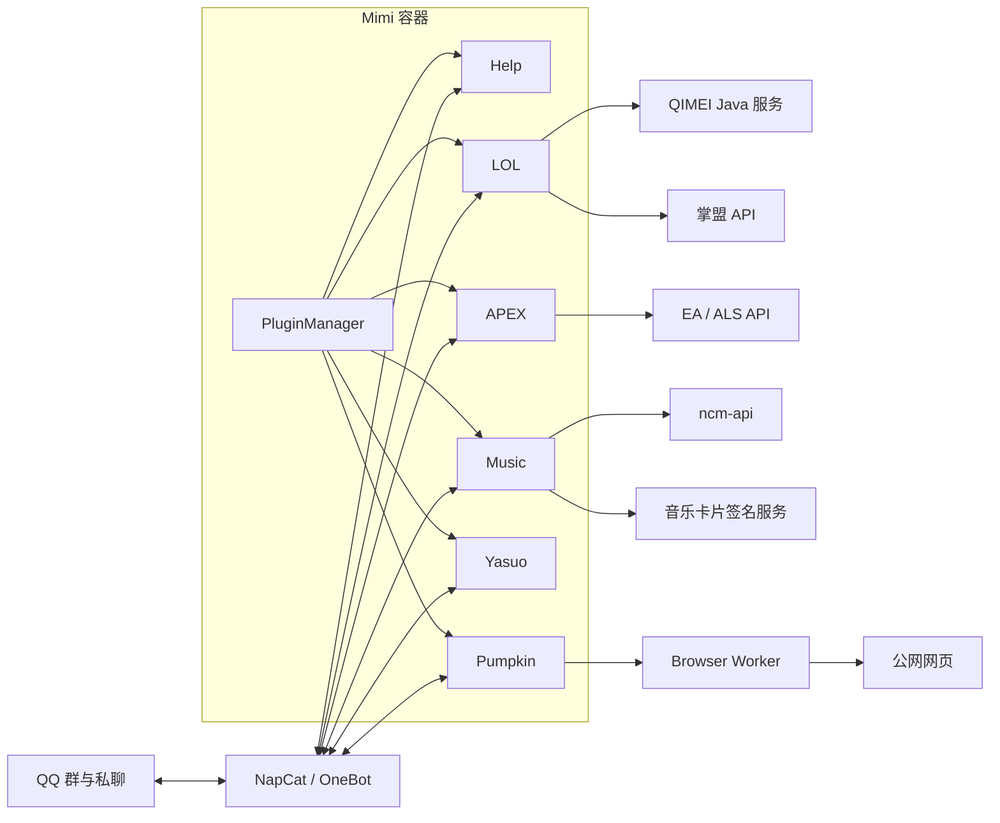

# Mimi Architecture

本文件是 Mimi 架构现状的唯一描述来源，回答“系统长什么样、组件如何交互、状态归谁”。
实现约束和验证门槛见 [`AGENTS.md`](AGENTS.md)，特性形成过程见
[`docs/feature/`](docs/feature/README.md)。本文只描述当前分支，不记录临时方案。

## 鸟瞰

Mimi 是基于 NapCat/OneBot 的插件化 QQ 机器人。仓库采用单仓库、多进程结构：

- Docker Compose 提供 NapCat、网易云 API、QIMEI、Mimi，以及可选的代码与浏览器 Worker。
- Mimi 根进程扫描 `plugins/*`，校验命令清单并启动插件子进程。
- 每个插件拥有独立 Python 环境、NapCat WebSocket、业务代码和运行数据。
- 插件之间不直接导入；共享的是环境变量、NapCat 服务和明确的 HTTP 服务。



## 运行视图

| 运行单元 | 职责 | 状态 |
| --- | --- | --- |
| `napcat` | QQ 登录、OneBot 事件与消息发送 | `data/napcat/` |
| `ncm-api` | 网易云搜索、登录和账户接口 | 外部服务状态 |
| `qimei` | 通过 Unidbg 与原生库注册 QIMEI36 | `data/qimei/` 仅缓存 APK |
| `mimi` | 根进程与全部插件子进程 | 插件数据卷 |
| `code-runner` | Pumpkin 隔离代码执行 | 单次请求临时目录 |
| `browser-worker` | Pumpkin 单租约 Playwright Chromium 进程 | 单次委派临时目录 |
| `browser-code-runner` | 无网络 Safe Python 程序沙箱与 SDK broker | 单次程序子进程 |

`mimi/main.py` 创建 `PluginManager`。管理器扫描 `plugins/` 的直接子目录，读取
`commands.toml` 并做全局、大小写不敏感的命令去重，然后在每个插件目录执行
`uv run main.py`。插件 stdout/stderr 由独立线程转发到根日志。管理器为每个插件保留
独立监管线程；子进程异常退出时记录退出码，并以 1 秒起步、60 秒封顶的指数退避重新拉起，
连续稳定运行 5 分钟后重置退避。根进程正常停止时先关闭监管，再终止插件，避免停机期间
误拉起。

插件自行建立 NapCat WebSocket 并处理断线重连。这个设计用额外连接换取依赖与故障隔离；
插件级异常由管理器隔离并恢复，根进程或容器级异常由 Compose 重启策略处理。

## 源码视图

```text
mimi/
  main.py                 # composition root
  plugin.py               # 插件发现、命令校验、子进程管理
  client.py               # 根 NapCat 客户端
plugins/
  help/                   # 命令清单聚合与帮助海报
  lol/                    # 掌盟登录、战绩、详情与海报
  apex/                   # EA 战绩、绑定与地图轮换
  music/                  # 网易云搜索、登录与音乐卡片
  yasuo/                  # 群消息归档、撤回海报与查询 API
  pumpkin/                # Harness Agent、TaskRuntime、Artifact 与能力插件
    browser/              # 隔离 Playwright Worker、UDS 协议与页面执行
qimei/
  src/main/java/qimei/    # QIMEI HTTP、APK 校验、Unidbg 调用
```

复杂插件采用以下依赖方向：

```text
main / config
    -> dispatcher
        -> feature handlers
            -> HTTP services / auth
            -> dataclass domain models
            -> Tortoise persistence models
            -> poster context
                -> Jinja2 template
                -> asset cache
                -> pytakumi PNG
```

入口负责装配与生命周期，dispatcher 只匹配命令，feature 编排用例，服务层隔离外部协议，
模型层表达数据，渲染层只消费稳定上下文。早期插件尚未完全统一，但新增代码遵循该方向。

## 状态所有权

| 状态 | 所有者 | 存储 |
| --- | --- | --- |
| QQ 登录与 NapCat 配置 | NapCat | `data/napcat/` |
| APEX 用户绑定与资产 | APEX 插件 | `data/mini/plugins/apex/data/` |
| LOL 端游/手游独立用户绑定、唯一共享会话、设备 profile、QIMEI36 | LOL 插件 | `data/mini/plugins/lol/data/` |
| 群消息、撤回事件与下载图片 | Yasuo 插件 | `data/mini/plugins/yasuo/data/` |
| Agent Inbox、Session Event、任务、Artifact、Outbox 与表情资产 | Pumpkin 插件 | `data/mini/plugins/pumpkin/data/` |
| Qwen 克隆音色档案与模型权重 | 宿主机 Qwen3-TTS 服务 | 外部服务运行目录 |
| QIMEI 所需固定 APK | QIMEI 服务 | `data/qimei/` |
| 网易云 Cookie | Music 插件 | 配置的数据文件 |

运行数据不属于源码，不进入 Git 或 Docker 构建上下文。QIMEI 服务不拥有设备身份；
LOL 插件以 profile digest 校验 QIMEI36 缓存，缓存未命中时才调用服务。

Pumpkin 每个 QQ scope 只有一个长期 Conversation Agent。`runtime/ingress.py` 负责适配、
归档、唤醒边界和写入持久化 Inbox；消息进入 Turn/Step AgentLoop 后由 Session Event
恢复模型上下文。Conversation Inbox 在尚未领取的条目中优先处理用户消息，后台 TaskEvent
单 Turn 最多使用 6 个模型步骤，避免任务通知长期阻塞明确唤醒。TaskEvent 全量持久化，
但只有等待输入、失败、暂停和无产物的完成事件进入 Conversation Inbox；带产物的完成
事件由 `TaskEventNotifier` 直接调用 `DeliveryService.send_event`，通过 Artifact gate 和
Outbox 交付，不等待串行 Conversation Agent。交付失败只发布必要失败通知，恢复查询同时
检查事件关联的 Outbox 防止重复交付。候选 Artifact、进度和
描述更新不触发用户回复。`runtime/task_runtime.py`
独立负责任务调度、并发、revision 过期、取消和恢复；Task Executor 只执行任务并登记
Artifact，不直接发送 QQ 消息。Task Executor 最后两个模型步骤只允许终态工具；步骤耗尽
但已有已验证 Artifact 且没有待核验纠正条件时，由 Runtime 提交部分完成结果；存在纠正
条件时仅保留候选产物，不复制条件 ID 宣称验收通过。网页资源错误使用
`ToolErrorScope.RESOURCE`，不会因重复同源失败终止整项任务；权限和操作错误仍有界止损。
群聊参与资格由 Ingress 和 `ChatSessionService` 共同执行。每次明确唤醒创建独立
`topic_id`；普通回答默认关闭话题，只有 Conversation Agent 在可见回复后显式提交
`requester_input` 或 `group_open`，请求人或群成员才能在 5 分钟空闲窗口和 15 分钟硬上限
内继续。排队的追问和扩散在领取时再次校验话题，已关闭或过期的条目直接丢弃。任务创建
成功后即使确认发送结果未知也关闭聊天话题。群聊 Session Projection 只向模型保留当前
`topic_id` 的 Turn，TaskEvent 不引入无关聊天，私聊仍保留最近四个已结束 Turn。
回复已确认的助手消息时，`AgentSession.reply_reference` 仅投影同 scope 的原始问题与
实际发送正文作为有界 `reference_only` 资料，不恢复旧工具、任务权限或话题状态。
聊天发送工具必须声明 `casual_chat`、`professional_answer` 或 `task_status` 回复模式；
模式只约束表达方式，不按参与类型限制回答长度。
`reply_and_complete` 复用 ChatToolService 发送校验与回复台账，一次发送并结束 Turn，
由 Runtime 管理幂等键和确认消息 ID。用户消息返回普通正文时，AgentLoop 持久化合成的
工具调用并走同一路径；已发送回复不重复发送，空正文不能静默成功。TaskEvent 和 Task
Executor 不使用正文自动发送路径。
合并回复的幂等值绑定当前 Turn，不同回合不能复用上一条发送结果。
Music `点歌`：Conversation Agent 按需加载 Chat-only `music-command` Skill，通过普通
聊天回复发送纯文本 `点歌 <歌曲名>[-歌手名]`。NapCat 将机器人自发文本作为
`message_sent` 回流，Music 只允许该事件进入点歌处理；登录、登出和账号信息仍只接受
原有用户事件与管理员边界。Pumpkin 不把该回复声明为音乐卡片已成功。
`runtime/artifacts.py` 负责 Artifact 校验、原子写入、来源指纹和纠正门禁。聊天回复和
确定性任务终态通知统一写入 Outbox，再由唯一 sender 发送。候选 Artifact 事件不具备
交付 capability；只有完成或部分完成的终态 revision 才能交付。纠正验收条件使用稳定 ID
并兼容旧文本，违规次数按纠正、revision 和原因隔离。
`runtime/task_verification.py` 使用当前任务模型单次独立核验纠正条件，只输入实际候选
内容和 Runtime 证据引用，不接受执行器历史或完成声明作为证明。只有全部条件 passed
才允许完成；部分完成只核验声明已满足的纠正条件，并要求进度说明和剩余事项，
不把未满足的成功条件计为纠正违规。产物拒绝门禁和浏览器图片核验仍生效。
unknown、格式不可读和模型失败保留候选文件。成功核验缓存复用 idempotency，
绑定 task、scope、revision、条件和内容摘要；完成锁内再次核对，TaskEvent 仅记录摘要证据。
模型核验不提供客观语义保证，未被纠正的原任务沿用原契约。任务状态迁移由确定性 TaskService
校验。`persistence/` 只提供 Tortoise 模型、按领域 Repository 和
`PumpkinStore` 组合入口，不承载恢复或验收策略；启动恢复由 `runtime/recovery.py`
编排。基础设施由 `core/services.py` 的具名 Service Definition 通过插件管理器装配；
`runtime/turn_policy.py` 按强类型 Inbox 来源生成每轮 capability/loadout，工具执行层
再次校验 capability。`runtime/task_events.py` 是用户可见 TaskEvent 的唯一通知入口，
按产物和终态选择直接交付或 Conversation Inbox；实时通知与启动恢复复用同一策略。

Pumpkin 在消息归档后把群聊顶层 `image` 和 `mface` 段登记为持久化候选，不等待网络
下载。`runtime/stickers.py` 的单 worker 异步完成安全下载、内容及感知去重、视觉分类、
隐私过滤和文件原子写入。跨群共享活跃库最多 50 个；满库后按北京时间每天最多替换
10 个，旧资产移动到日期归档目录。收集不改变群聊参与决策。Conversation Agent 通过
`sticker-reply` Skill 查询受控元数据并使用 `sticker_id` 发送，不能构造媒体路径或
`mface` 参数；发送继续经过 Outbox、Turn capability 和回复预算。群内成员也可引用单个
原始媒体请求全局移除；Runtime 只从当前引用解析目标，写入哈希墓碑并清理资产文件，
防止后台重新收集。

Pumpkin 音频能力在启动时选择 `MinimaxAudioProvider` 或
`QwenLocalAudioProvider`。MiniMax Provider 访问云端 TTS；Qwen Provider 通过 HTTP 访问
宿主机 MPS 服务，执行授权音色克隆和 WAV 合成。参考音频只从当前 Task 的源消息按需读取，
不写入 Session Event 或 Artifact。Agent 只使用统一的 `generate_audio` 与
`clone_voice` 契约，Provider 差异由 `providers/audio/` 内部适配。克隆成功后，最新音色
指针由 Pumpkin 原子持久化。MiniMax ASR 独立装配，可与任一 TTS Provider 组合。
完整任务只交付一个音频 Artifact 时，交付层使用不带引用、@ 或重复完成文案的单条
`record` 消息；部分完成和异常结果仍保留必要说明。

Pumpkin 的 `search_web` 继续通过 `httpx` 调用受认证搜索 API；`fetch_url` 对任意公网
来源的 GET 请求则由 `WreqWebTransport` 承担，并以 `output=text|artifact`
区分网页正文与通用文件 Artifact。文件下载写入独立 Artifact，允许不同 URL 并发执行；
同一 URL 由 Turn 预算去重。该 Transport 固定 Chrome Linux Profile，禁用系统代理和自动
重定向，并在每次请求前解析、校验并固定全部公网 DNS 地址。重定向由 Provider 有界处理，
每个目标重新执行 DNS 校验；响应按页面和文件各自上限流式读取。`wreq` 对象与异常不会
越过 Provider 边界，也不会失败后静默回退到 `httpx`。

搜索请求只传 `query` 与 `max_results`，不固定地区和语言路由。网页图片以独立的候选
URL 与 alt 元数据返回；图片文件在登记 Artifact 前经过解码和尺寸校验，下载结果同时向
模型提供受限首帧预览，原始文件保持不变。TaskRuntime 从归档消息恢复
`original_user_requests`，与助手整理的 handoff 分开展示；原话和明确纠正定义执行目标，
技能授权不允许把查找现成资源自行改为创作。内容相关性仍由 Agent 依据预览与原请求验收。

需要动态页面读取、公开页面交互、截图或 PDF 时，Task Agent 只调用高层
`delegate_browser_task`。Mimi 内的短生命周期 Browser Controller 使用隔离模型上下文，
但与 Conversation/Task 共用 `AgentLoop` 的步骤调度、Provider 调用、工具调用数量校验和
Trace。Browser Profile 固定每步一个工具调用、禁止并行，模型结果由 Controller 执行并
回灌下一步，预算耗尽前必须收敛到显式终态。Browser 不接入 Session 的 Turn/Step 事件、
Skill 渐进加载、通用工具批次或 Conversation/Task 完成工具；单动作、页面版本、动作后
断言、副作用冻结和最终证据门禁仍由 Controller 独立拥有。
公开工具只接收一个完整 `goal`；Browser Profile 在共享 `AgentLoop` 的首个步骤根据目标和
归档用户原话生成起始 URL、目标类型、输出类型、能力与证据约束，不启动独立 Compiler
循环。工具预算只计委派次数，不按 URL 缓存浏览器结果；
浏览器 capability 按 scope/task/revision 绑定唯一完整目标。Controller 通过协议 v3 的
`execute_program` 与共享 Unix Domain Socket 调用 `browser-worker`。Worker
每次委派启动全新的 Playwright、Chromium、BrowserContext 和 Page，拥有唯一 lease、
临时 profile、DOM、Cookie 和 Storage；终态、取消或超时后强制回收。
Worker 不挂载插件数据或 Mimi secrets，只加入独立公网出站网络；Mimi 不加入该网络。
Chromium 使用容器网络执行网页原生请求、后台查询、WebSocket、Service Worker 和跳转；
无公网地址、同源或 HTTP 方法权限规则，起始 URL 只校验 HTTP(S) 格式。
Browser Agent 生成受限 Python 程序，通过 `browser_execute` 调用
注入的 Safe Browser SDK；不接触原始 Playwright、locator、JavaScript 或网络接口。
`browser-code-runner` 独立容器使用非 root、只读文件系统、无网络与资源上限，
每段程序启动独立子进程并安装 Linux seccomp；子进程仅持有预连接 pipe，
SDK capability 由 supervisor broker 注入，不能读取 SDK socket 或其他进程。
Worker 只解析通用 HTML/ARIA、label、fieldset 和 open shadow DOM，不推断题目与站点语义。
观察同时保留普通 DOM 容器、真实父引用与直接文字，find 可按局部文字、tag、form_name
和 within 范围定位重复入口。投影和范围筛选在浏览器内批量读取，不逐节点往返。
模型观察以默认字段表无损压缩，并只发送一次最新观察；累计动作记录独立回灌，
不随纯观察程序清空。另保留最多 24 KiB 的程序源码与小型返回值历史，
不复制旧观察或动作台账，省略时显式标记。进度记录仅在本次委派内用于恢复执行，
不能替代实时页面证据，也不进入持久化日志。SDK 返回完整属性对象。
Cookie、Header、Storage 和 CDP
不进入工具契约。截图和 PDF 返回
Mimi 后写入当前 Task revision 的 Artifact。成功结果只包含最终页面状态的产物；
部分完成的过程截图标为 `diagnostic`，不能晋升为交付产物。浏览器截图逐张核验文字
可读性及原任务要求，发送前通过同一内容核验服务重检，拦截历史乱码与中间态截图。
核验证据绑定文件摘要和具体图片，无法用另一张正常图片替旧图通过验收。
Browser Profile 契约阶段产出的目标通过 URL 格式与产物模式校验后，Controller 每轮只
允许一个程序或完成工具。契约不预设成功提示的精确文字，执行 Agent 根据实际页面核对
用户目标并引用最终证据。默认最多 12 次决策、8 段程序，每段最多 30 秒、32 KiB 源码；
Worker 对一次 run 限制 200 次 SDK 调用。填值、勾选和选择后自动核验直接状态，
`fill_many` 先预检全部项，再逐条执行，失败保留已完成动作记录。
普通局部变量（包括 `_`）可用；双下划线运行时名称、私有属性和危险 Python 操作仍禁用。
校验失败回灌完整错误字段，不消耗程序执行次数。每步提供剩余时间和决策次数，
最后一次决策只开放完成工具；每段程序的超时上限同时受剩余执行时间约束。
共享 `AgentLoop` 接受可选的单次请求截止时间，Browser Profile 使用已配置的模型时限，
并预留一段程序时限用于最终捕获和收尾；不依赖 HTTP 分阶段超时作为整次模型调用上限。
修改结果不确定时冻结后续修改，不重放副作用。
完成前 Worker 刷新观察并捕获最终产物；动作序号独立于页面版本，
`observed_after_action_seq` 必须覆盖最后动作。证据文本和 facts 必须来自最终页面，
完成参数类型或精确引文错误允许一次只开放完成工具的纠正，重新捕获页面并执行原门禁；
页面状态不符、观察不完整、结果未知或产物身份错误不进入此纠正路径。
未确认动作或产物身份不一致时，只能部分完成。Controller 不维护持久化 checkpoint
或第二套浏览器验收逻辑。
value/checked/selected 是可选的目标字段断言，不要求填满全部字段或同名勾选组。
业务动作由 AI 决定，`interaction_mode` 不控制 SDK 权限；普通点击与 Enter 可直接提交，
原生提交方法和事件保持网页语义，`submit` 仅为带可选断言的点击别名。
没有提交窗口、单次提交上限或业务动作分类拒绝。页面原生校验、可选字段、多步骤和
跨站跳转由网页执行；AI 通过 `wait_for` 按文字、精确 URL 或可见 ref 等待目标状态，
不依赖全局 `networkidle`。等待超时不冻结动作，也不自动重放此前操作。
Worker 核对最终精确证据及产物身份；AI 按原目标解释业务结果，不能仅凭 HTTP 成功结项。
已知确认文本可选，不要求预测其他表单的文案。模型超时、输出耗尽和执行期限到达时
先捕获最终页面，再用剩余决策预算进行一次只开放 finish 的模型核验，共用最终门禁；
总时限内预留最多一段程序时长，短任务最多预留一半，收尾不重放业务动作。
核验不可用、预算耗尽或结果未知时保留观察与部分完成。模型默认单次 180 秒、
输出 16384，总执行 720 秒，
仍受父任务截止时间和交付预留约束。父 Task 模型超时或输出耗尽时复用已验证产物的
部分完成兜底，纠正条件与交付门禁仍生效。
归档用户原话独立于父任务整理的目标传入每个执行及恢复核验轮，不写入 Worker 契约。
原生 dialog 以类型、文字、默认输入和唯一 ID 交给模型显式处理，触发动作保持 pending
直到处理结束；新页面采用相同协议。动作台账按序号合并确认更新，type 返回真实光标与
选区编辑后的状态。父任务完成门禁读取统一操作状态并兼容已有模式缓存；
所有模式均要求显式 completed、goal_verified=true 且结果确定。
`TaskRuntime` 持有单调截止时间，Controller 按父任务剩余时间减交付预留执行。
容量不足时由 Runtime 在同一次委派中
最多等待 45 秒，并受父截止时间约束，不额外调用模型。Worker 租约绑定 Mimi 实例和
scope/task/revision 摘要，续期和取消同时校验租约与所有者。
Mimi 每 5 秒独立连接发送心跳，Worker 心跳失联 30 秒回收，900 秒硬租约保持兜底。
终态、取消、版本纠正及关闭统一等待清理，重复取消不能跳过回收；
客户端清理有 5 秒上限，失联则由 Worker 回收。根进程、Pumpkin 与 Worker 的 SIGTERM
进入关闭流程；Compose 提供 init 与停止宽限时间，正常关闭先停止接收浏览器委派。
Worker 串行执行 SDK 调用。每个 ref 绑定具体节点、frame 和文档代次；
填写值、checked、selected、滚动和新观察不会使 ref 失效，节点替换、文档导航、
frame 分离或语义改变会返回 `BROWSER_REF_STALE`，不重新按位置命中另一节点。
动作返回同时区分执行状态和 checked、value、URL 或 ARIA 页面状态等直接效果。动作已发送
但结果未知时封锁后续修改，不重放副作用。执行前的不可见、禁用或不可编辑状态返回精确
批次索引与 ref 字段；执行后的 Playwright 异常按结果未知处理。
浏览器操作标识由 Runtime 根据 scope/task/revision 与目标摘要内部生成，不暴露给 Agent。
同一任务版本只执行一个完整浏览器目标，阻止改写目标或 URL 重开；同次委派可导航多个页面。
运行中合并请求，终态复用结果，执行前持久化预留；中断无终态时阻止重放。
跨委派不恢复页面。完成候选先检查当前观察出处和产物版本。
snapshot 包含最多 48K 字符正文与 5,000 个节点引用，截断会明确标记并阻止完成。
页面理解和控件组合由 Browser Agent 完成。SDK 的 find/get/read/assert 不开放任意
JavaScript；不维护表单进度或站点适配器。每次观察产生新 observation_id，
只有内容投影变化才递增 resource_version；document_epoch 以文档对象身份判断，
iframe 导航不改变主文档代次。DOM 值存在不代表页面接受，完成仍需最终页面证据。
SDK 请求绑定 run、execution、capability、单调序号和参数摘要；重复请求复用结果，
冲突或乱序明确拒绝。程序执行、失败、超时和取消都会吊销执行票据。
Controller 核对 Worker SDK 版本与能力，不授权替代交互方式或截图范围。
终态及幂等缓存保留带 run_id 的 `execution_report`、最后观察、最近动作和结果未知状态，
不能跨 run 推断结果。失败过程截图只登记 diagnostic Artifact，不能晋升为最终交付。
产物来源摘要绑定 run、资源版本和捕获身份。只读结果携带已有交互报告；
`TaskCommandService` 在完成前及完成锁内检查原交互终态，未核验交互只能部分完成。

Pumpkin 的有效数据路径只有：

```text
NapCat -> MessageIngress -> MessageArchive -> AgentInbox
       -> AgentLoop -> SessionEvent -> Tool / TaskService / ArtifactService
       -> Outbox -> NapCat
```

## LOL 核心链路

管理员通过 QQ OAuth 建立唯一共享掌盟会话。普通用户绑定 Riot ID、手游角色名或直接
输入昵称，插件先按游戏类型搜索玩家，再查询战绩：

```text
昵称
  -> /go/customize_search/search_type_keyword
  -> scene + uuid + area_id
  -> /go/battle_info/get_battle_list
  -> 能力信息 + 各局详情
  -> 中文战绩海报
```

手游链路使用 `gameId=lgame` 和搜索结果的 `lgameIntent`，再调用
`/go/lgame_battle_info/battle_list`、`overview` 和 `detail_v2`。端游与手游共享登录态，
但绑定表和进程内最近查询状态彼此独立。

掌盟请求固定使用 `lolapp/12.8.1 (Android)` User-Agent。模式以 `game_queue_id`
判断：`450` 为极地大乱斗，`3270` 为海克斯大乱斗。掌盟未提供的隐藏分/MMR 不估算。

登录时，LOL 插件把设备原生配置发送给 QIMEI 服务。QIMEI 服务串行运行 ARM64
`libqimei.so`，返回 QIMEI36；插件将其作为 `mcode` 完成掌盟登录并持久化票据。

## 架构不变量

1. 业务功能留在 `plugins/<name>/`，根 `mimi/` 只做进程编排和基础连接。
2. 插件之间不直接依赖代码，通过外部服务或明确契约协作。
3. 数据获取、领域模型与 HTML/Markdown 渲染分离。
4. `commands.toml` 的真实触发词全仓库唯一。
5. LOL 查询必须先搜索取得目标身份，再调用战绩接口。
6. QIMEI 服务保持无设备状态，并保留在仓库根目录。
7. Cookie、Token、OAuth 回调、设备标识和数据库不进入日志、文档或 Git。
8. `data/` 与插件数据目录不进入 Docker 构建上下文。
