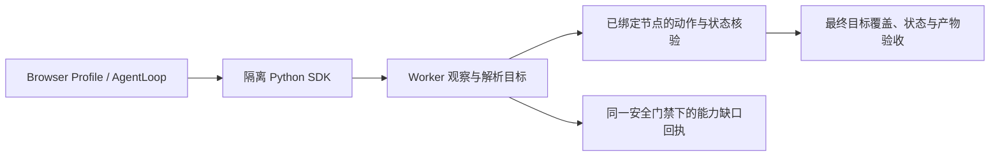

# Pumpkin Browser Safe SDK 与开源浏览器执行设计核验

## 1. 范围与判断

核验对象是 [Code Execution 设计](design.md)及当前工作树中的实现，重点判断复杂表单失败
是否来自架构、能力契约或实现。当前系统边界以 [ARCHITECTURE.md](../../../ARCHITECTURE.md)
为准。本报告补充 [原调研](research.md)中未完成的固定版本源码核验，不改写其历史判断。

**执行架构部分对齐，页面观察与定位能力尚未对齐。** 共享 AgentLoop、持续浏览器现场、
代码组合工具、动作反馈与最终取证都值得保留。差异主要是 Pumpkin 将操作目标限制为
自制 HTML/ARIA 投影中的 ref，同时删除 selector、任意页面 JavaScript 和视觉操作。
开源项目采用更丰富的 DOM 投影或提供其他定位路径，不能仅因同样支持代码执行，就认为
Safe SDK 已取得同等页面覆盖能力。[cite:1](#source-1)[cite:2](#source-2)[cite:4](#source-4)[cite:8](#source-8)

这不是推翻 Worker、Runner 或 AgentLoop 的依据。标准表单已能通过现有 SDK 操作；
当前真实问卷同时暴露了可修复的点击预检问题，以及观察契约无法充分表达自定义界面的
问题。减少模型往返和扩大可表达动作是两个独立目标。

## 2. 方法、版本与限制

GitHub 源码通过 GitHub CLI 读取并下载固定提交，不以 README 宣传或动态文档单独证明
实现。版本号来自对应提交中的包元数据，表示被核验快照，**不表示最新稳定发布版本**。

| 项目 | 核验提交 | 提交时间（UTC） | 快照内版本 |
| --- | --- | --- | --- |
| Microsoft Playwright MCP | `404be8eb89abecff77a55152b6d843d140c78372` | 2026-11-06 | `0.0.84` |
| MCP 对应 Playwright 实现 | `2344315c542af22002c132567b5a66464e7f4db6` | 由 MCP roll 提交指定 | alpha 依赖实现 |
| Browser Use | `b49a68e4060acb226da8f784194fef301c53a6d7` | 2026-10-30 | `0.13.14` |
| Stagehand | `d9cb8ccb8f9f4d07aaeb33cd634d76baabdc4295` | 2026-11-08 | TypeScript SDK `4.4.0` |

Playwright MCP 仓库的 `src/README.md` 指向 Playwright monorepo。核验继续追踪其固定依赖，
实际工具位于 `packages/playwright-core/src/tools/backend/`，观察实现位于
`packages/injected/src/ariaSnapshot.ts`。[cite:1](#source-1)[cite:2](#source-2)[cite:3](#source-3)

本次没有运行上游 Agent、重新填写真实问卷或比较成功率。已有失败证据来自
[真实模型重测报告](../../../plugins/pumpkin/tests/output/questionnaire-retest-20261109/report.md)：
最终逐题核验为 0/23，问卷未提交。该测试走 ModelProvider、BrowserAgentRunner、Worker、
Runner，未覆盖 QQ/NapCat 入口和 Outbox；不能据此推断完整生产链路表现。

“树形观察加其他定位路径”在三个独立项目中得到交叉支持；“隔离代码通过 RPC 组合工具”
另由 Cloudflare Codemode 官方文档支持。具体 ref 失效条件、网络策略和完成判据属于各
项目自己的设计，不存在已经核验的统一行业协议。[cite:1](#source-1)[cite:4](#source-4)[cite:8](#source-8)[cite:11](#source-11)

## 3. 三个开源项目实际提供的能力

| 维度 | Playwright MCP | Browser Use | Stagehand v4 |
| --- | --- | --- | --- |
| 观察 | AI 模式保留 generic role、树结构、可见性和指针事件信息；仍有裁剪 | DOM、AX、布局与可交互性结合，输出树和元素 index | DOM 与 AX 混合快照，frame、节点和 XPath 映射 |
| 定位 | snapshot ref，也接受 selector 或 locator 表达式 | 基于节点的 index；有视觉坐标路径和 evaluate | observe 产生 selector/method/arguments，也可直接 locator |
| 自定义控件 | 更宽的 generic 投影；遗漏时可 selector/evaluate/可选坐标操作 | 事件监听、tabindex、ARIA、cursor 等信号；有额外启发式规则 | 混合快照加 selector；页面 API 另支持坐标和 evaluate |
| 代码与编排 | `browser_run_code_unsafe` 将原始 Page 交给 JavaScript | 逐步工具动作；evaluate 是页面 JavaScript，不能等同独立 Python SDK | harness 编排；可混用 AI primitives 与确定性 Page API |
| 安全可比性 | 官方明确不是安全边界，unsafe code 为 RCE-equivalent | 工具能力包含文件、上传和页面 JS，宽于 Pumpkin | 页面 API 包含 evaluate、header、init script 等，宽于 Pumpkin |
| 完成语义 | 提供动作、快照和验证工具；应用仍需自己的任务验收 | done 的 success 来自 Agent；judge 结果不覆盖该 success | act 返回动作结果；不等价于整个业务任务完成 |

表中能力分别依据固定源码与官方 Page API，不能外推为任何网站都能成功。
[cite:1](#source-1)[cite:2](#source-2)[cite:3](#source-3)[cite:4](#source-4)[cite:5](#source-5)[cite:6](#source-6)[cite:7](#source-7)[cite:8](#source-8)[cite:9](#source-9)[cite:10](#source-10)

### 3.1 Playwright MCP 并非只读标准 ARIA 控件

`toInternalOptions()` 的 AI 模式明确使用 `includeGenericRole: true`、
`visibility: 'ariaOrVisible'` 和 `refs: 'interactable'`。ref 依据节点上的 `_ariaRef`
复用，role/name 变化时重新分配；不要求填写字段后所有 ref 都失效。
不过 generic 的部分 inline 文本节点会被省略，随后还有快照裁剪，因此它也不是完整 DOM。
[cite:1](#source-1)

`Tab.targetLocators()` 接受 ref，也接受 CSS/locator；`browser_click` 解析目标后调用
Playwright 的 click。除此之外，核心工具提供页面 evaluate 和明确标为 unsafe 的代码
执行，坐标操作另行启用。**“稳定 ref 为主”不等于“只能操作一份有限的 ref 列表”。**
[cite:2](#source-2)[cite:3](#source-3)

### 3.2 Browser Use 的能力来自多种信号，不是标准 label 推断

`ClickableElementDetector.is_interactive()` 包含 JS click listener、嵌套控件 wrapper、
tabindex、ARIA 属性和 pointer cursor 等判断；serializer 再结合可见性分配 index，
保留树形文字上下文与 backend node 映射。[cite:4](#source-4)[cite:5](#source-5)

其中也有 search class/id 关键词和特定 wrapper 启发式规则。这说明成熟开源项目也会
付出复杂度代价，不能将其整套识别逻辑视为通用最佳实践。适合 Pumpkin 借鉴的是
DOM 关系、事件与可操作性信号；不建议复制其关键词规则或添加问卷站点 adapter。

该项目的 evaluate 和坐标动作是额外能力，不代表稳定 index 本身能覆盖全部页面。
同样，`_judge_and_log()` 注释明确写出 judge 不覆盖 `last_result.success`；独立评估
可以记录偏差，却不能自动建立 Pumpkin 所需的完成门禁。[cite:6](#source-6)[cite:7](#source-7)

### 3.3 Stagehand 保留 AI 候选和确定性操作两条路径

`captureHybridSnapshot()` 构建 DOM index 与 AX tree，支持按 locator 缩小观察范围，
并合并 frame 对应关系。`observeService` 将模型选出的元素 ID 映射为 XPath Action；
`actService` 接到 Action 对象时进入确定性执行，接到自然语言才运行推理流程。
[cite:8](#source-8)[cite:9](#source-9)

官方 v4 Page API 还提供 locator、坐标 click 和 evaluate。这支持“不要把所有执行
能力收缩到标准语义控件”的判断，但不要求 Pumpkin 加一个 observe 模型，也不要求
迁移到 Stagehand。其 v4 runtime 通过 CDP 操作浏览器，不应描述为直接复用 Playwright
依赖的框架。[cite:10](#source-10)

## 4. 当前设计逐项对齐情况

本节实现依据：
[controller.py](../../../plugins/pumpkin/browser/controller.py)、
[references.py](../../../plugins/pumpkin/browser/references.py)、
[engine.py](../../../plugins/pumpkin/browser/engine.py)、
[safe_sdk.py](../../../plugins/pumpkin/browser/safe_sdk.py)和
[gate.py](../../../plugins/pumpkin/browser/gate.py)。

| 当前设计 | 判断 | 依据与实际含义 |
| --- | --- | --- |
| 共享 AgentLoop、独立 Browser Profile | 合理，已落地 | Controller 确实使用 AgentLoop；浏览器权限与现场可继续独立维护，无需新增模型循环 |
| Python 组合受控 RPC 工具 | 模式对齐 | Codemode 同样由隔离代码组合宿主工具；Python、Docker 和三段程序上限是本项目选择 [cite:11](#source-11) |
| 浏览器现场跨程序保持 | 已对齐 | Controller 没有要求前一程序失败才继续；按预算和 unknown 决定工具可用性 |
| 节点 ref 与观察版本分离 | 方向对齐 | Playwright AI ref 也随节点语义复用；Pumpkin 检查更多约束，节点替换后拒绝是刻意取舍 [cite:1](#source-1) |
| 标准 label、fieldset、within | 已有，但覆盖有限 | `within` 已实现；`parent_ref` 是最近语义分组，不是完整 DOM 父节点 |
| 自定义控件和上下文观察 | 未充分对齐 | `_COLLECT` 排除无 role 的普通 div/span；三个上游均保留更丰富结构或其他定位路径 [cite:1](#source-1)[cite:4](#source-4)[cite:8](#source-8) |
| 无 selector、JS、视觉备用路径 | 刻意取舍造成能力缺口 | 不是隔离架构错误，但缩小了可处理页面集合；不能声称已继承完整 Playwright 能力 |
| 隐藏 input 必须有标准可见 label | 合理默认，非通用解法 | 原生 check 也要求可操作性；自定义入口应作为独立可见目标操作 [cite:12](#source-12) |
| click 前将所有 href 按 HTTP URL 验证 | 已复现的实现与契约问题 | 本地脚本入口被按跨 origin 导航拒绝；不能简单将所有 javascript URL 放行 [cite:13](#source-13) |
| 动作核验、unknown 冻结 | 方向合理 | fill/check/select 核验直接状态；不需要因上游策略更宽就删除 |
| 最终捕获与动作出处核验 | 方向合理，已比旧草案完善 | capture 前后比较投影，包含 finalization；不再只是先观察后给截图贴版本号 |
| 文本 evidence 证明任务完成 | 尚不充分 | 子串存在不证明所有目标状态；当前 Gate 不用 checked/selected 构造结构化完成条件 |
| 六次决策、三段程序 | 未经充分评测的默认预算 | 可控上限有价值，但上游资料和当前一次失败都不能证明其普适性 |

## 5. 真实问卷失败的责任划分

### 5.1 已复现的实现问题

`engine._preflight()` 在 click 目标存在 href 时直接调用 `validate_url()`。
问卷可见选项入口使用本地 JavaScript 链接，因此尚未点击就返回
`navigation is outside allowed public origins`。它证明当前错误分类和点击策略不适合该
入口，不证明网站实际发生了跨域导航。

JavaScript URL 也不能一概称为“无害伪链接”：脚本可运行任意页面行为，结果是字符串
时甚至会替换文档。建议区分真实 HTTP(S) 导航与已观察页面入口的激活；如果支持后者，
仍由 Worker 执行已授权点击、约束网络与提交并核验结果，模型不能传入脚本。
具体支持范围必须明确写入契约。[cite:13](#source-13)

首段程序将 `snapshot()` 返回对象当字典，属于模型使用 API 错误。当前 Prompt 写明
`-> object`，实现也返回 SimpleNamespace，不能称为“文档承诺 dict、实现返回 object”。
不过接口形态仍值得统一：snapshot、Element 与嵌套 options 的访问方式不完全一致，
模型文档又是手写字符串。可从类型定义生成精确 API 文档与可运行示例，降低纠正成本；
这与 Codemode 从工具 schema 生成类型的原则一致。[cite:11](#source-11)

### 5.2 能力契约问题

全部题目共用一个 fieldset，而 `parent_ref` 只指向语义分组。普通题目 wrapper 不在引用
集合中，即使已提供 `within`，模型也缺少能表达“这道题所在子树”的作用域 ref。
这比“增加分组方法”更具体：**已有查询方法的候选集合与结构信息不够。**

隐藏 radio/checkbox 没有标准可见 label，`check` 明确返回 unsupported 是诚实行为。
直接 force-click 隐藏 input、修改 checked 属性或塞入站点 selector，不能替代对真实可见
入口的通用定位。当前缺口在于没有稳定表达这些入口及其局部关系的能力。
[cite:4](#source-4)[cite:8](#source-8)[cite:12](#source-12)

这次失败没有证明任何单个改动就能完成 23 项，也没有证明模型必然无法用更丰富的通用
观察完成。需要在修复已知误判后，用同模型、同任务、同预算重测来分离剩余原因。

### 5.3 完成门禁的额外设计缺口

`BrowserResultGate._observed_text()` 合并 title、visible_text、元素 name/text/value 等字符串；
`finish()` 主要检查 evidence/facts 是否为其子串，未构造“目标集合都满足期望状态”的
判据。题目标题在空表单上同样存在，不能支撑“已填完”。

这次模型主动报告 failed，**没有实际误报 completed 的证据**；上述结论来自静态条件
核验，是潜在验收缺口，与本次导致 0/23 的操作失败分开处理。

保留观察出处、动作台账和 capture identity，再补结构化状态验收：模型可提出关联 ref
及预期 value/checked/selected，Worker 在最终观察重新读取并给出结果。模型提出的目标
集合还须覆盖用户请求，不能只验证它挑选的一项；复杂目标无法确定覆盖范围时保持
未验证或部分完成。不要把“所有断言为真”等同“用户目标完整覆盖”。

## 6. 建议收敛方向

建议保留执行骨架，扩展少量通用定位和状态能力。以下是研究建议，未修改实现。

| 顺序 | 建议 | 验证重点 |
| --- | --- | --- |
| 1 | 修正本地交互入口的预检分类与错误反馈，固定 SDK 类型契约 | 普通导航、重定向、页面脚本入口、提交拒绝；对象访问示例真实可执行 |
| 2 | 扩展通用观察：DOM 父子关系、局部文字、可见入口与实际可操作性 | 无 ARIA 的 wrapper、重复选项、共享 fieldset、动态 DOM；无站点 class/关键词规则 |
| 3 | 标准 ref 不足时允许只读目标解析，返回唯一节点绑定的 ref | 可采用通用 text/DOM 查询或受限 selector；歧义拒绝、跨 frame 和失效语义清晰 |
| 4 | 完成候选包含结构化最终状态与目标覆盖证据 | 空表单标题不能通过；填后重置、遗漏字段、多选数量不足不能通过 |
| 5 | 用固定 fixture 与真实模型基线评估预算 | 同模型、同任务、同预算，区分定位失败、执行失败和模型耗时 |

“只读目标解析”是一个能力接口，不要求恢复原来多工具、多阶段 Controller。
SDK 仍可只有一个程序工具；解析在程序内调用，得到节点 ref 后仍走同一动作门禁。
如采用 selector，优先只允许定位，禁止 evaluate 和 DOM 修改，并明确不能用 selector
绕过秘密、提交、URL 或动作策略。也可先扩大树形 ref 覆盖，再依据测试决定是否需要它。
[cite:2](#source-2)[cite:9](#source-9)

不建议现在同时添加任意 JS、坐标动作、完整 Playwright Page 和新一层 Agent。
这些能力在上游确实存在，但三者都不是解决当前可见 DOM 入口问题的唯一必要条件。
先恢复可见入口的可表达性，保留动作验证与隔离，再以缺口 fixture 决定下一项能力。

本报告不建议为了填表放开所有 POST。非 GET 请求拦截与任务效果必须分开；阻断遥测不
等于导航失败，允许 DOM 交互也不证明任意网站绝无远端写入。公网与提交边界仍需独立
维护，不能从“上游支持”推出“本项目应无条件授权”。

## 7. 对既有判断的修正

- “执行骨架可保留”得到源码与 Codemode 模式支持；“需要调整观察和动作空间”得到三个
  独立项目支持。
- 当前实现已有 `within`、group_by、稳定 ref、open shadow DOM 和成功后的连续程序，
  不应继续列为待补能力。
- Playwright MCP 的 AI 快照不是纯标准 ARIA：它也纳入 generic 节点，并提供其他定位
  路径。仍存在裁剪，不能因此宣称它完整覆盖所有 DOM。
- 严格节点 ref 是可选择的语义，不需要改成每次自动命中新节点的 locator。
- 拒绝无标准 label 的隐藏控件是合理的明确失败；可见操作入口无法表达才是需要处理
  的通用能力缺口。
- SDK 对象被按 dict 访问不是已证实的文档实现不一致；应优化接口清晰度，而不是用
  Prompt 特殊规则修补一次程序。
- 不能称当前完成门禁已经证明任意目标完成，也不能将开源 judge 当作同等证明。

## 8. 验证与未执行项

本轮完成三个项目固定版本源码核验、Playwright MCP 依赖追踪、官方文档交叉核验及当前
实现条件检查。只新增本研究文档，没有修改实现、原设计、运行配置或已有研究报告。

文档交付执行 `git diff --check`，并检查相对路径与引用完整性。没有重新运行单元测试、
Chromium 集成测试、模型问卷评测或上游 Agent；报告引用的既有测试结果不算本轮验证。
没有部署或重启服务。

## 9. 来源

[cite:1] Microsoft Playwright：AI snapshot、generic role 与节点 ref。
[固定源码](https://github.com/microsoft/playwright/blob/2344315c542af22002c132567b5a66464e7f4db6/packages/injected/src/ariaSnapshot.ts#L58-L70)，
[ref 分配](https://github.com/microsoft/playwright/blob/2344315c542af22002c132567b5a66464e7f4db6/packages/injected/src/ariaSnapshot.ts#L224-L268)。

[cite:2] Microsoft Playwright：MCP 目标解析及点击。
[Tab.targetLocators](https://github.com/microsoft/playwright/blob/2344315c542af22002c132567b5a66464e7f4db6/packages/playwright-core/src/tools/backend/tab.ts#L592-L643)，
[snapshot/click 工具](https://github.com/microsoft/playwright/blob/2344315c542af22002c132567b5a66464e7f4db6/packages/playwright-core/src/tools/backend/snapshot.ts)。

[cite:3] Microsoft Playwright MCP：安全边界、备用能力及代码执行。
[固定 README](https://github.com/microsoft/playwright-mcp/blob/404be8eb89abecff77a55152b6d843d140c78372/README.md)，
[evaluate](https://github.com/microsoft/playwright/blob/2344315c542af22002c132567b5a66464e7f4db6/packages/playwright-core/src/tools/backend/evaluate.ts)，
[runCode](https://github.com/microsoft/playwright/blob/2344315c542af22002c132567b5a66464e7f4db6/packages/playwright-core/src/tools/backend/runCode.ts)。

[cite:4] Browser Use：通用信号及启发式可交互节点识别。
[ClickableElementDetector](https://github.com/browser-use/browser-use/blob/b49a68e4060acb226da8f784194fef301c53a6d7/browser_use/dom/serializer/clickable_elements.py)。

[cite:5] Browser Use：树形观察、backend node 与 index 分配。
[DOMTreeSerializer](https://github.com/browser-use/browser-use/blob/b49a68e4060acb226da8f784194fef301c53a6d7/browser_use/dom/serializer/serializer.py#L649-L770)，
[树序列化](https://github.com/browser-use/browser-use/blob/b49a68e4060acb226da8f784194fef301c53a6d7/browser_use/dom/serializer/serializer.py#L989-L1201)。

[cite:6] Browser Use：页面 JavaScript 与坐标工具。
[evaluate](https://github.com/browser-use/browser-use/blob/b49a68e4060acb226da8f784194fef301c53a6d7/browser_use/tools/service.py#L1833-L1855)，
[坐标工具注册](https://github.com/browser-use/browser-use/blob/b49a68e4060acb226da8f784194fef301c53a6d7/browser_use/tools/service.py#L2121-L2158)。

[cite:7] Browser Use：done 自报与独立 judge 的真实关系。
[_judge_and_log](https://github.com/browser-use/browser-use/blob/b49a68e4060acb226da8f784194fef301c53a6d7/browser_use/agent/service.py#L1629-L1645)，
[done](https://github.com/browser-use/browser-use/blob/b49a68e4060acb226da8f784194fef301c53a6d7/browser_use/tools/service.py#L2008-L2044)。

[cite:8] Stagehand：DOM/Accessibility 混合观察。
[captureHybridSnapshot](https://github.com/browserbase/stagehand/blob/d9cb8ccb8f9f4d07aaeb33cd634d76baabdc4295/packages/extension/understudy/a11y/snapshot/capture.ts)，
[DOM index](https://github.com/browserbase/stagehand/blob/d9cb8ccb8f9f4d07aaeb33cd634d76baabdc4295/packages/extension/understudy/a11y/snapshot/domTree.ts)。

[cite:9] Stagehand：observe 产生 Action，act 确定性执行。
[observeService](https://github.com/browserbase/stagehand/blob/d9cb8ccb8f9f4d07aaeb33cd634d76baabdc4295/packages/extension/services/observeService.ts)，
[actService](https://github.com/browserbase/stagehand/blob/d9cb8ccb8f9f4d07aaeb33cd634d76baabdc4295/packages/extension/services/actService.ts)。

[cite:10] Stagehand v4 官方动态文档，2026-11-09 读取：
[介绍与 runtime](https://docs.stagehand.dev/v4)，
[Page API](https://docs.stagehand.dev/v4/reference/page)。

[cite:11] Cloudflare Codemode 官方动态文档，2026-11-09 读取：
[类型生成、RPC、Executor 与默认网络隔离](https://developers.cloudflare.com/agents/api-reference/codemode/)。
文档仍标 Beta/experimental；本次未固定其包源码版本。

[cite:12] Playwright 官方动态文档，2026-11-09 读取：
[Locators](https://playwright.dev/docs/locators)，
[Auto-waiting / Actionability](https://playwright.dev/docs/actionability)。

[cite:13] MDN：JavaScript URL 的执行与文档替换语义，2026-11-09 读取。
[javascript: URLs](https://developer.mozilla.org/en-US/docs/Web/URI/Reference/Schemes/javascript)。
